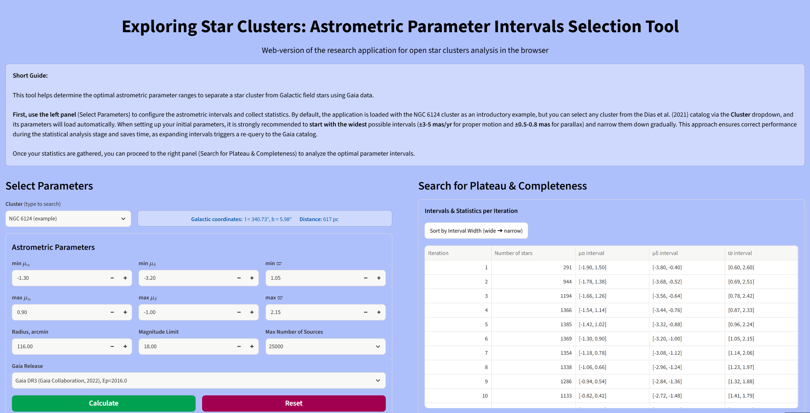
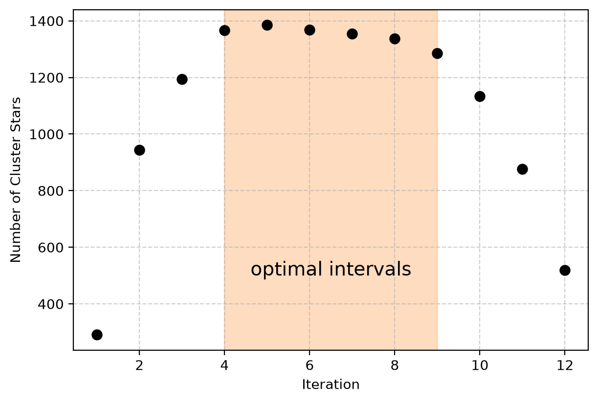

# ESCAPIST — Exploring Star Clusters: Astrometric Parameter Intervals Selection Tool

*(formerly SCAPST, "Star Cluster Astrometric Parameters Selection Tool")*

**Live app: <https://scapst.streamlit.app/>** — open it in a browser, no installation needed.

A web application for finding the **optimal astrometric intervals** (proper motion and parallax) for separating an open star cluster from the Galactic field, using Gaia data. It runs in the browser and is built with [Streamlit](https://streamlit.io).

> The original desktop (Tkinter) program are described in:
> V. O. Mikhnevich, A. F. Seleznev. *Method for selecting stars from Gaia EDR3 for statistical investigation of an open cluster.* Ural Federal University, 2022.



*The start page: short guide, parameter inputs on the left, iteration table on the right.*



*Cluster star count versus iteration for the NGC 6124 example. The shaded band marks the plateau, which is the optimal parameters interval (iterations 4–9).*

> **Note on the hosted version.** Apps on free Streamlit hosting go to sleep after a period of inactivity. If you see a "this app has gone to sleep" page, press the button to wake it up; it restarts in a few moments. The first Gaia query after that can take a few minutes.

---

## Why this tool exists

Member stars of an open cluster formed from the same molecular cloud and move as a gravitationally bound system, so they share a common mean parallax and mean proper motion. The observed dispersion of the individual values around these means is small, and is set by the cluster's internal velocity dispersion, its depth along the line of sight, and the astrometric measurement errors. The selection corridor in ($\mu_\alpha$, $\mu_\delta$, $\varpi$) has to be wide enough to contain the cluster members and narrow enough to exclude field stars. These two requirements conflict, and the width determines which one wins.
For each cluster there is a range of intervals where the statistically determined number of cluster stars is **maximal and roughly constant** (a *plateau*). ESCAPIST helps you find it: you narrow the intervals step by step, watch the colour–magnitude diagram, the sky map and the cluster star count, and the app records every step so the plateau becomes visible.

## Features

- Choose a cluster; its position, proper motion and parallax are filled in automatically. NGC 6124 is preloaded as a worked example.
- Choose the Gaia release: **DR3**, **EDR3** or **DR2**.
- Set proper-motion ($\mu_\alpha$, $\mu_\delta$) and parallax ($\varpi$) intervals, cluster radius, magnitude limit and maximum number of sources.
- Live statistics for the current selection:
  - most probable $\mu_\alpha$, $\mu_\delta$, $\varpi$ (1-D kernel density estimate), with the corresponding tangential velocities and distance;
  - total number of stars in the area, number inside the cluster circle, number in a background ring of equal area, and the **background-adjusted number of cluster stars**.
- Diagrams: colour–magnitude diagram, sky map in Galactic coordinates (with the cluster circle and background ring), and $\mu_\alpha$, $\mu_\delta$, $\varpi$ versus G magnitude.
- An **iteration table** and a **star count vs. iteration** plot for finding the plateau; the table can be sorted by interval width and exported as CSV.
- Data are downloaded once for the widest intervals and **re-filtered locally** while you narrow them; a new Gaia query is made only when you widen the selection.
- Automatic **fallback servers** if the ESA Gaia Archive is unavailable (ARI Heidelberg, then VizieR on the fastest reachable mirror).

## Quick start

### Use online

Open <https://scapst.streamlit.app/>, pick a cluster and press **Calculate** (see [How to use](#how-to-use)).

## How to use

1. **Pick a cluster** in the *Cluster* drop-down (type to search), or keep the NGC 6124 example.
2. **Start with wide intervals.** A good first guess is about $\pm 3-5$ mas/yr in proper motion and $\pm 0.5-0.8$ mas in parallax around the cluster values. Starting wide matters: widening later triggers a new Gaia query, narrowing does not.
3. Set **Radius, arcmin** (cluster radius), **Magnitude Limit**, **Max Number of Sources** and the **Gaia Release**.
4. Press **Calculate**. The first run downloads the data and may take a few minutes.
5. Read the results: modes of the distributions, star counts, and the diagrams.
6. **Narrow the intervals** a little (for example by the same step on every limit), press **Calculate** again, and repeat. Each press adds a row to the iteration table.
7. In the right panel, look at **Cluster Star Count vs. Iteration**. The intervals where the count stays maximal and roughly constant are the optimal ones. Use *Sort by Interval Width* if you did not narrow monotonically, *Save Table* to export the CSV, and *Clear Table* to start over.
8. **Reset** clears the cache and the session and returns to the NGC 6124 example.

### Worked example: NGC 6124

The preset reproduces the setup of the paper (centre l = 340.73°, b = +5.98°, radius 116′, G ≤ 18). Narrowing the intervals in 12 steps gives a plateau for steps 4–9, i.e. deviations of about $\pm(0.86-1.34)$ mas/yr in proper motion and $\pm(0.37-0.73)$ mas in parallax from the most probable values. The right-hand table is preloaded with the paper's values for this cluster, and the plateau is shaded in the plot. Exact counts from a live query can differ slightly from the example.

## Inputs and outputs

| Input | Meaning |
|---|---|
| Cluster | Name and parameters from the [Dias et al. (2021)](https://scixplorer.org/abs/2021MNRAS.504..356D/abstract) catalogue, or the NGC 6124 example; Fixes the center (l, b) |
| min/max $\mu_\alpha$, $\mu_\delta$, $\varpi$ | Selection intervals (mas/yr, mas/yr, mas) |
| Radius, arcmin | Cluster radius; The downloaded area is a box of $\pm 3$ radii around the center |
| Magnitude Limit | Gaia G-band limit |
| Max Number of Sources | Upper limit on rows returned (25 000 … unlimited) |
| Gaia Release | DR3, EDR3 or DR2 (waiting  for DR4)|

| Output | Meaning |
|---|---|
| $\mu_\alpha$, $\mu_\delta$, $\varpi$ (modes) | Most probable values from a 1-D kernel density estimate |
| $V_\alpha$, $V_\delta$, distance | Tangential velocities as 4.74 $\mu/\varpi$ in km/s, and distance as $1000/\mu$ in pc |
| Stars in the area / circle / ring | Counts after the interval selection |
| Cluster stars, background-adjusted | Circle count minus ring count |
| Iteration table and plot | One row per **Calculate**, used to find the plateau |

## Repository layout

```
SCAPST.py          # the whole application (Streamlit)
logoimg.png        # page icon, read at start-up
requirements.txt   # Python dependencies
README.md          # this file
docs/TECHNICAL.md  # architecture, algorithms, caching, limitations
docs/images/       # screenshots used in this README
```

## Documentation

- [Technical description](docs/TECHNICAL.md): architecture, data flow, algorithms, caching rules, known limitations.

## Known limitations (short list)

- The cluster centre comes from the catalogue; it is not re-estimated and cannot be edited in the interface.
- The colour–magnitude diagram shows apparent G magnitude against observed BP−RP (no distance or extinction correction).
- If the number of returned rows reaches *Max Number of Sources*, the sample is silently truncated.
- Choosing the plateau is done by eye; there is no automatic fit.

See [docs/TECHNICAL.md](docs/TECHNICAL.md#12-known-limitations-and-open-issues) for the full list.

## Data sources and acknowledgements

This work uses data from the European Space Agency (ESA) mission [Gaia](https://www.cosmos.esa.int/gaia), processed by the Gaia Data Processing and Analysis Consortium (DPAC, <https://www.cosmos.esa.int/web/gaia/dpac/consortium>). It also uses the VizieR catalogue access tool, CDS, Strasbourg (DOI: 10.26093/cds/vizier), the [Dias et al. (2021)](https://scixplorer.org/abs/2021MNRAS.504..356D/abstract) cluster catalogue, and the [astropy](https://www.astropy.org) and [astroquery](https://astroquery.readthedocs.io) packages.

## Authors

V. O. Mikhnevich

## License

MIT
