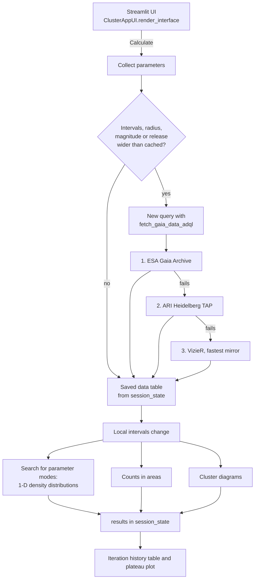

# ESCAPIST — Technical Description

*Exploring Star Clusters: Astrometric Parameter Intervals Selection Tool* (formerly SCAPST). Public instance: <https://scapst.streamlit.app/>.

This document describes how the application in `SCAPST.py` works: architecture, data flow, algorithms, caching and known limitations. It describes the code as it is, including its imperfections (section 12). For installation and usage see the [README](../README.md).

## Contents

1. [Purpose and scientific background](#1-purpose-and-scientific-background)
2. [Architecture overview](#2-architecture-overview)
3. [Data sources](#3-data-sources)
4. [Data flow of one "Calculate" click](#4-data-flow-of-one-calculate-click)
5. [Gaia data retrieval](#5-gaia-data-retrieval)
6. [Caching and re-query logic](#6-caching-and-re-query-logic)
7. [Algorithms](#7-algorithms)
8. [Visualisation](#8-visualisation)
9. [Session state](#9-session-state)
10. [Constants and tunable parameters](#10-constants-and-tunable-parameters)
11. [Dependencies and deployment](#11-dependencies-and-deployment)
12. [Known limitations and open issues](#12-known-limitations-and-open-issues)
13. [Comparison with the 2022 desktop version](#13-comparison-with-the-2022-desktop-version)
14. [References](#14-references)

---

## 1. Purpose and scientific background

Members of an open cluster share an origin, so their parallaxes $\varpi$ and proper motions $\mu_\alpha$, $\mu_\delta$ have a small spread. Cutting the Gaia catalogue by astrometric **intervals** removes most field stars, but:

- an interval that is too wide keeps field stars, and large-scale fluctuations of the field density distort the statistics;
- an interval that is too narrow cuts away cluster members because of astrometric errors.

Members cannot be identified individually this way, so the cluster is studied statistically: the number of cluster stars is estimated as the star count inside the cluster circle minus the count in a background ring. The tool computes this number for a series of progressively narrower intervals. The intervals where the number is maximal and approximately constant (the plateau) are taken as optimal.

## 2. Architecture overview

The application is a single Python file, `SCAPST.py`, run by Streamlit. Streamlit re-executes the whole script on every interaction, so state that must survive between interactions is kept in `st.session_state` or in Streamlit's cache.



### Code map

| Name | Kind | Role |
|---|---|---|
| `VIZIER_MIRRORS` | constant | List of VizieR mirror host names |
| `get_fastest_vizier_mirror()` | function (`st.cache_resource`, TTL 1 h) | Sends a `HEAD` request to each mirror (timeout 1.5 s) and returns the fastest that answers; default `vizier.cfa.harvard.edu` |
| `LinDens` | class | One-dimensional kernel density estimate on a regular grid (step 0.1), using a quartic kernel of half-width (delta=0.3); the grid node with the highest density gives the most probable value of a parameter |
| `findcentres()` | function | Runs `LinDens` for  $\mu_\alpha$, $\mu_\delta$ and $\varpi$ and returns the three density maxima |
| `fetch_dias_clusters()` | function (`st.cache_data`) | Downloads the Dias et al. (2021) catalogue from VizieR |
| `fetch_gaia_data_adql()` | function (`st.cache_data`) | Downloads the Gaia table for the selected area and intervals, with fallback servers |
| `get_tap_table_name()` | function | Maps the release choice to the ESA table name |
| `plotting_diagramms()` | function | Sets diagram structure |
| `plot_cluster_diagrams()` | function | Builds the figures (CMD + sky map; $\mu_\alpha$, $\mu_\delta$, $\varpi$ versus G magnitude) |
| `ClusterAppUI` | class | Builds the interface and runs the calculation (`render_interface`) |

## 3. Data sources

| Source | Used for | Access |
|---|---|---|
| ESA Gaia Archive | Primary source of Gaia data | `astroquery.gaia.Gaia`, ADQL via TAP, asynchronous job |
| ARI Heidelberg Gaia TAP (`gaia.ari.uni-heidelberg.de/tap`) | First fallback (partner data centre, same table and column names) | `astroquery` `TapPlus`, asynchronous job |
| VizieR Gaia catalogues | Second fallback | `astroquery.vizier.Vizier.query_region` on the fastest mirror |
| Dias et al. (2021), VizieR `J/MNRAS/504/356` | List of clusters; centre, proper motion, parallax, distance | `astroquery.vizier.Vizier.get_catalogs`, row limit 2000 |

Release mapping:

| Interface choice | ESA / ARI table | VizieR table | Epoch |
|---|---|---|---|
| Gaia DR3 | `gaiadr3.gaia_source` | `I/355/gaiadr3` | 2016.0 |
| Gaia EDR3 | `gaiaedr3.gaia_source` | `I/350/gaiaedr3` | 2016.0 |
| Gaia DR2 | `gaiadr2.gaia_source` | `I/345/gaia2` | 2015.5 |

The Dias catalogue is read with `get_catalogs`; the code uses the first returned table that has a cluster-name column (`Cl*`, `Name` or `Cluster`) and stores the name in a `Name` column. The columns `RA_ICRS`, `DE_ICRS`, `pmRA`, `pmDE`, `Plx` and `Dist` are used when present.

## 4. Data flow of one "Calculate" click

1. All widget values are collected into a dictionary `p`: centre (l, b), the six interval limits, radius, magnitude limit, maximum rows, ESA table name and cluster name. It is stored as `calc_params`.
2. The app decides whether a new query is needed (section 6). If so, `fetch_gaia_data_adql` is called inside an `st.status` box; otherwise the stored table `raw_gaia_df` is reused.
3. The table is filtered locally by the three intervals (`pmra`, `pmdec`, `parallax` between their min and max, inclusive). The result is `df_sel`; its length is *Total number of stars in the area*.
4. `findcentres` computes the density maxima of $\mu_\alpha$, $\mu_\delta$, $\varpi$ (section 7.2). Distance and tangential velocities are derived from them.
5. The circle and ring counts are computed and the background-adjusted cluster count is obtained (section 7.3).
6. The figures are built, the results are stored in `session_state["results"]`, and one row is appended to the iteration history of the current cluster (section 7.4).
7. After the left-hand calculation, the interface renders the results, and the right-hand panel renders the iteration table and plot.

If the query fails or returns an empty table, `results` is set to `None` and the app shows "No data retrieved via ADQL".

## 5. Gaia data retrieval

### 5.1 Query area

The downloaded area is a **box in Galactic coordinates** around the cluster centre (l₀, b₀) with half-width

```
r_box = 3 · R / 60   [deg]        (R = cluster radius in arcmin)
```

so the box contains the cluster circle (radius R) and the background ring (outer radius √2·R) with margin.

### 5.2 ADQL query (ESA and ARI)

```sql
SELECT [TOP N]
  source_id, ra, ra_error, dec, dec_error, l, b,
  parallax, parallax_error, pmra, pmra_error, pmdec, pmdec_error,
  phot_g_mean_mag, phot_bp_mean_mag, phot_rp_mean_mag, bp_rp
FROM gaiadr3.gaia_source          -- or gaiaedr3 / gaiadr2
WHERE l  BETWEEN l0 - r_box AND l0 + r_box
  AND b  BETWEEN b0 - r_box AND b0 + r_box
  AND pmra   BETWEEN pmra_min  AND pmra_max
  AND pmdec  BETWEEN pmdec_min AND pmdec_max
  AND parallax BETWEEN plx_min AND plx_max
  AND phot_g_mean_mag <= G_lim
```

- `TOP N` is added for a numeric *Max Number of Sources* and omitted for "Unlimited". There is no `ORDER BY`, so if the limit is reached, the returned rows are an arbitrary subset.
- For ESA, `Gaia.ROW_LIMIT` is set to the same value (−1 for unlimited) and the job is run with `launch_job_async(..., dump_to_file=False)`.
- For ARI the same query is used with one extra condition in front, an ICRS cone `CONTAINS(POINT('ICRS', ra, dec), CIRCLE('ICRS', ra0, dec0, 1.5·r_box)) = 1`, which covers the whole box (box corners are at most √2·r_box from the centre) and lets the server use its sky index. The exact l/b cuts still apply.

### 5.3 Fallback chain

`fetch_gaia_data_adql` tries the servers in this order and stops at the first success:

1. **ESA Gaia Archive**.
2. **ARI Heidelberg**: first a `HEAD` request with a 10 s timeout checks that the server is reachable (otherwise a blocked connection would hang for about two minutes). The job is then submitted in the background and polled every 3 s; the progress bar shows the job phase and the time waited. The wait is limited by `ari_timeout_s` (60 s) and the job is aborted on timeout.
3. **VizieR** on the mirror chosen by `get_fastest_vizier_mirror()`. A cone search (`Vizier.query_region`) with radius `√2·r_box` is used, with the proper-motion, parallax and magnitude cuts passed as `column_filters`, a row limit equal to *Max Number of Sources*, and a timeout of 60 s.

After a VizieR download the code :
(a) renames the columns to the Gaia-archive names (`Source → source_id`, `RA_ICRS → ra`, `DE_ICRS → dec`, `Plx → parallax`, `pmRA → pmra`, `pmDE → pmdec`, and so on); 
(b) computes `l` and `b` from `ra`/`dec` with astropy;
(c) applies the exact l/b box, taking the wrap at l = 0°/360° into account.

If all servers fail, one error message lists the error of each, and an expander shows the query and the Python traceback.

### 5.4 Post-processing (all servers)

If `bp_rp` is missing or entirely empty, it is computed as `phot_bp_mean_mag − phot_rp_mean_mag` (or set to 0 if those columns are absent too).

## 6. Caching and re-query logic

There are four cache layers.

| Layer | Mechanism | Key / lifetime | Purpose |
|---|---|---|---|
| Wide-interval table | `st.session_state["raw_gaia_df"]` and `["last_queried_params"]` | One browser session; cleared when the cluster changes or on Reset | Download once, then filter locally while the intervals are narrowed |
| Query result | `@st.cache_data` on `fetch_gaia_data_adql` | The full argument tuple; cleared when the cluster changes and on Reset | Identical repeat queries are not sent again |
| Dias catalogue | `@st.cache_data` on `fetch_dias_clusters` | Until the cache is cleared | Load the cluster list once |
| Fastest mirror | `@st.cache_resource(ttl=3600)` | 1 hour | Do not probe the mirrors on every run |

### Rule for a new Gaia query

On **Calculate**, `p` is compared with the parameters of the last *actual* query (`last_queried_params`). A new query is made if **any** of these holds:

- `pmra_min` or `pmdec_min` or `plx_min` is lower than before, or `pmra_max` or `pmdec_max` or `plx_max` is higher (an interval has become wider);
- the radius is larger than before;
- the magnitude limit is larger than before;
- the Gaia release (ESA table name) differs.

Otherwise the stored table is reused, an information message says so, and no network request is made. A narrower selection is always a subset of the stored table, so local filtering gives the same result as a new query would. `last_queried_params` is updated only after a successful query, so the stored table always corresponds to the widest area requested since the last cluster change.

### Not covered by the rule

- A change of **Max Number of Sources** does not trigger a new query. A table downloaded with a lower limit stays in use after the limit is raised.
- Failed or empty results are removed from the cache immediately after the call.

## 7. Algorithms

### 7.1 Selection by intervals

```
df_sel = df[ pmra_min ≤ pmra ≤ pmra_max
           & pmdec_min ≤ pmdec ≤ pmdec_max
           & plx_min ≤ parallax ≤ plx_max ]
```

The intervals are closed. The number of rows of `df_sel` is the *Total number of stars in the area*.

### 7.2 Most probable values: 1-D kernel density estimate

`findcentres(inarr, maglim, delta, step, a, d, z)` receives an array of rows `(parallax, pmra, pmdec, G)` from `df_sel` and three ranges for $\mu_\alpha$, $\mu_\delta$ and $\varpi$. It builds three independent one-dimensional densities with the class `LinDens` and returns the position of each maximum.

**Grid.** For a parameter with the range `[x_min, x_max]`, the grid nodes are `x_i = x_min + i·step`, `i = 0 … int((x_max − x_min)/step) − 1`, with `step = 0.1` (mas/yr for proper motion, mas for parallax).

**Kernel.** Every star with `G ≤ `*Magnitude limit* and value `x` adds to the grid nodes within `±delta` of `x` the quartic kernel

```
K(x_i; x) = 15/16 · [1 − ((x − x_i)/δ)²]² / δ      for |x − x_i| ≤ δ,  otherwise 0
```

with the half-width `δ = 0.3`. The kernel integrates to one, so the grid values are an estimate of the probability density.

**Result.** The estimated mode is the node with the highest density, `x_mode = x_{argmax}`; it is `NaN` if the density is empty. Because the grid step is 0.1, **modes are quantised to 0.1** of the parameter unit.

**Window logic.** `LinDens` supports an inner window for selecting which stars contribute (a star adds to the μα density only if its μδ lies in the μδ inner window, and vice versa; ϖ uses its own window). The app passes the interval limits as both outer and inner bounds (`[min, min, max, max]`). Since `df_sel` already lies inside the interval, the inner windows do not exclude anything: all selected stars with `G ≤ maglim` contribute to all three densities.

**Derived quantities** (in `render_interface`):

```
distance  d  = 1000 / ϖ_mode                [pc]
V_α = 4.74 · μα_mode / ϖ_mode               [km/s]
V_δ = 4.74 · μδ_mode / ϖ_mode               [km/s]
```

If `ϖ_mode ≤ 0` or is `NaN`, the distance and velocities are set to 0. No parallax zero-point correction is applied.

### 7.3 Number of cluster stars (circle minus ring)

Distance of each selected star from the cluster centre (l₀, b₀), in degrees:

```
ρ = sqrt( (l − l₀)² + (b − b₀)² )
```

With `R_deg = R/60`:

```
N_circle  = #{ ρ ≤ R_deg }
N_ring    = #{ R_deg < ρ ≤ √2 · R_deg }
N_cluster = max(0, N_circle − N_ring)
```

The ring has outer radius √2·R, so its area `π(2R² − R²) = πR²` equals the area of the circle. The estimate therefore assumes a **uniform distribution of field stars** and a **spherically symmetric cluster** that lies entirely inside the circle. The centre (l₀, b₀) is fixed (section 12).

### 7.4 Iteration history and plateau search

Each **Calculate** appends one row to `session_state["cluster_history"][cluster_name]` with:

| Column | Content |
|---|---|
| Iteration | Row number |
| Width | Sum of the three interval widths $\Delta\mu_\alpha$ + $\Delta\mu_\delta$ + $\Delta\varpi$; used for sorting, not displayed |
| Number of stars | `N_cluster` |
| $\mu_\alpha$, $\mu_\delta$ and $\varpi$ intervals | The selection limits |
| $\mu_\alpha$, $\mu_\delta$ and $\varpi$ mode | Density maxima (`N/A` if undefined) |

The right-hand panel shows this table, with an optional sort by width (wide to narrow, rows renumbered), a CSV export, and *Clear Table*. The plot *Cluster Star Count vs. Iteration* shows number of stars against the iteration number. The **plateau is judged by eye**: the app does not fit a curve or detect it automatically. For the NGC 6124 example the iterations 4–9 are shaded and labelled "optimal intervals" (hard-coded values from the paper).

For the NGC 6124 example, the table is preloaded with Table 1 of the paper (12 samples, without the mode columns). It is created once per session unless **Reset** was used.

## 8. Visualisation

`plot_cluster_diagrams(df_sel, df, radius_am, l_med, b_med)` returns two Matplotlib figures (transparent background, 300 dpi):

- **Figure 1**, two panels:
  - colour–magnitude diagram: `bp_rp` on the x axis, `phot_g_mean_mag` on the y axis, y axis inverted;
  - sky map in (l, b) of the selected stars, with two circles, the cluster circle (radius R) and the ring boundary (radius √2·R), drawn in degrees centred on (l₀, b₀).
- **Figure 2**, three panels: `pmra`, `pmdec` and `parallax` against `phot_g_mean_mag`.

## 9. Session state

| Key | Content |
|---|---|
| `last_cluster` | Cluster selected on the previous run (used to detect a change) |
| `calculated` | `True` after the first Calculate |
| `calc_params` | The dictionary `p` of the last Calculate |
| `raw_gaia_df` | Stored wide-interval Gaia table |
| `last_queried_params` | `p` of the last successful query |
| `results` | Statistics, figures and counts of the last calculation (or `None`) |
| `cluster_history` | Dictionary: cluster name → list of iteration rows |
| `sort_wide_to_narrow` | Sorting toggle for the table and plateau plot |
| `reset_performed` | Set by Reset to stop the example table from being recreated |
| `cluster_preset_widget` | Value of the cluster selector |

Changing the cluster resets `calculated`, `results`, `calc_params`, `fig_r`, `raw_gaia_df` and `last_queried_params`, but keeps `cluster_history` (each cluster has its own list). **Reset** clears `st.cache_data` and the whole session state.

## 10. Constants and tunable parameters

| Value | Where | Meaning |
|---|---|---|
| `delta = 0.3` | call to `findcentres` | Kernel half-width |
| `step = 0.1` | call to `findcentres` | Density grid step |
| `3 · R / 60` | `fetch_gaia_data_adql` | Half-width of the downloaded box (deg) |
| `√2` | circle/ring computation and plots | Outer ring radius in units of R |
| `4.74` | velocity calculation | km/s per (mas/yr)/mas |
| `1.5 · r_box` | ARI and VizieR queries | Cone radius that covers the box |
| `ari_timeout_s=60` | `fetch_gaia_data_adql` | Maximum wait for the ARI job (s) |
| `10 s` | `fetch_gaia_data_adql` | ARI reachability check timeout |
| `v.TIMEOUT = 600` | `fetch_gaia_data_adql` | VizieR request timeout (s) |
| `timeout=1.5` | `get_fastest_vizier_mirror` | Mirror probe timeout (s) |
| `ttl=3600` | `get_fastest_vizier_mirror` | Mirror re-check period (s) |
| `row_limit=2000` | `fetch_dias_clusters` | Maximum clusters read from the Dias catalogue |
| `25000 … 500000, Unlimited` | *Max Number of Sources* selector | Row limit choices |

## 11. Dependencies and deployment

Direct imports: `streamlit`, `pandas`, `numpy`, `matplotlib`, `astroquery`, `astropy`, `requests`, `Pillow` (`PIL`). `scipy` is **not** used. The application was run with Python 3.12 on Streamlit Community Cloud.

The file `logoimg.png` is opened with `Image.open('logoimg.png')` at import time; the app fails to start without it.

A public instance is hosted on Streamlit at <https://scapst.streamlit.app/>. Free-tier apps go to sleep after a period of inactivity and wake up on the next visit.

The hosting machine needs outbound HTTPS access to at least one of the data servers (ESA, ARI, VizieR mirrors). A server that cannot be reached can cost up to about two minutes of waiting before the next fallback is tried (the ARI reachability check shortens this to 10 s).

## 12. Known limitations and open issues

1. **Cluster centre is not estimated.** The centre comes from the Dias catalogue (RA/Dec converted to l, b) or, for the NGC 6124 example, from fixed values (l = 340.73°, b = +5.98°). The interface has no input for the centre.
3. **Flat angular distances.** Distances in section 7.3 are Euclidean in (l, b) degrees, without the `cos b` factor for l and without the wrap at l = 0°/360°. This is a good approximation near the Galactic plane and for small radii, and degrades at high |b| or near l = 0°. (The VizieR fallback does handle the l wrap when cutting the box.)
4. **Silent truncation.** If the number of returned rows equals *Max Number of Sources*, the sample is incomplete, with no warning and no `ORDER BY`. The cluster count is then unreliable.
5. **Row-limit change does not refresh the table** (section 6).
7. **Mode resolution.** Density maxima are quantised to `step = 0.1`. For very narrow intervals (width comparable to `2·delta`) the kernel is truncated at the interval edge and the maximum is biased towards the interior.
8. **Distance and velocities** are simple inversions of the parallax mode: no zero-point correction and no uncertainty estimate. The tangential velocities exclude the radial velocity.
9. **Background subtraction** assumes a uniform field and a spherical cluster contained in the circle. In crowded fields near the plane, or for clusters with extended halos or tidal tails, `N_cluster` is a statistical estimate only, and it can be negative before the `max(0, …)` clipping.
10. **Plateau selection is manual.** There is no automatic plateau detection or curve fit; the shaded band is hard-coded for the NGC 6124 example only.
11. **History rows are not de-duplicated.** Pressing **Calculate** twice with identical inputs adds two identical rows.
12. **Fallback servers** are not guaranteed to hold exactly the same data as the ESA archive (for example a mirror may lag behind, or apply its own row cap). Gaia DR4 will initially be available from the ESA archive only. Only DR2, EDR3 and DR3 are offered in the interface.

## 13. Comparison with the 2022 desktop version

| Aspect | Desktop (paper, Tkinter) | Web version (this repository) |
|---|---|---|
| Interface | Tkinter, spin boxes | Streamlit, number inputs |
| Data input | Read from a local file; some parameters changed in the code | Live ADQL/TAP queries to Gaia (with fallbacks) and VizieR |
| Cluster selection | Fixed in the code | Drop-down with the Dias et al. (2021) catalogue |
| Cluster center | Estimated once with a 1-D KDE | Taken from the Dias et al. (2021) catalogue |
| Modes of $\mu_\alpha$, $\mu_\delta$, $\varpi$ | 1-D KDE | Same |
| Cluster count | Circle minus equal-area ring | Same |
| Iteration series | Done by hand, tabulated in the paper | Iteration table, sorting, CSV export and plot built in |
| Re-querying | Not applicable (file) | Wide table cached, local filtering, re-query only when widening |
| CMD y axis | Absolute magnitude $M_G$ | Apparent $G$ |

## 14. References

- [V. O. Mikhnevich, A. F. Seleznev, *Method for selecting stars from Gaia EDR3 for statistical investigation of an open cluster*, Ural Federal University, 2022](https://elar.urfu.ru/handle/10995/115949?locale=en).
- [Gaia Collaboration, Brown A. G. A., Vallenari A. et al., *The Gaia mission*, A&A 595 (2016)](https://scixplorer.org/abs/2016A%26A...595A...1G/abstract).
- [Gaia Collaboration, Brown A. G. A., Vallenari A. et al., *Gaia Data Release 2: Summary of the contents and survey properties*, A&A 616 (2018)](https://scixplorer.org/abs/2018A%26A...616A...1G/abstract).
- [Gaia Collaboration, Brown A. G. A., Vallenari A. et al., *Gaia Early Data Release 3: Summary of the contents and survey properties*, A&A 649 (2021)](https://scixplorer.org/abs/2021A%26A...649A...1G/abstract).
- [Gaia Collaboration, Brown A. G. A., Vallenari A. et al., *Gaia Data Release 3: Summary of the contents and survey properties*, A&A 674 (2023)](https://scixplorer.org/abs/2023A%26A...674A...1G/abstract).
- [Dias W. S. et al., *Updated parameters of 1743 open clusters based on Gaia DR2*, MNRAS 504, 356 (2021), VizieR `J/MNRAS/504/356`](https://scixplorer.org/abs/2021MNRAS.504..356D/abstract).
- [Ochsenbein F., Bauer P., Marcout J., *The VizieR database of astronomical catalogues*, A&AS 143, 23 (2000)](https://scixplorer.org/abs/2000A%26AS..143...23O/abstract).
- [Astropy Collaboration; Ginsburg A. et al., *astroquery: An Astronomical Web-querying Package in Python*, AJ 157, 98 (2019)](https://scixplorer.org/abs/2019AJ....157...98G/abstract).
